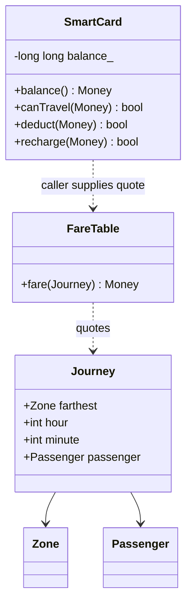
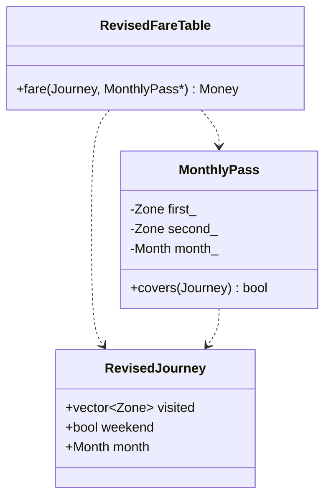

# Assignment report: Namma Metro Smart-Card Fare System

**Student name:** not supplied; GitHub account `vinoththecool7-netizen`
**Register number:** 192471006
**Repository:** https://github.com/vinoththecool7-netizen/DSA01-192471006-Assignment1
**Execution environment:** Apple clang 21.0.0, C++17, arm64 macOS.
**Evidence provenance:** assistant-authored analysis and assistant-run executions.

This report follows the attached Tasks 1–12. Per-task source, inputs and logs
are retained in the linked repository. The complete assignment text is in
`ASSIGNMENT_SPECIFICATION.txt`. Full execution commands and digests are in
each `evidence/manifest.json`; the summary is in `VALIDATION.md`.

Evidence limits: genuine text transcripts are included, but terminal screenshots,
student personal execution/prediction evidence, the student full name, and
confirmation against the unavailable SIMATS style guide remain incomplete.
Concession/pass ambiguities are documented assumptions. All task commits reflect
this actual work session; no week-long personal development history is claimed.

## Contents

- Task 1: `Task01/REPORT.md` and its executed programs
- Task 2: `Task02/REPORT.md` and its executed programs
- Task 3: `Task03/REPORT.md` and its executed programs
- Task 4: `Task04/REPORT.md` and its executed programs
- Task 5: `Task05/REPORT.md` and its executed programs
- Task 6: `Task06/REPORT.md` and its executed programs
- Task 7: `Task07/REPORT.md` and its executed programs
- Task 8: `Task08/REPORT.md` and its executed programs
- Task 9: `Task09/REPORT.md` and its executed programs
- Task 10: `Task10/REPORT.md` and its executed programs
- Task 11: `Task11/REPORT.md` and its executed programs
- Task 12: `Task12/REPORT.md` and its executed programs

---

## Task 1 — Objects and invariants

| Object | Data | Behaviour and justification |
|---|---|---|
| SmartCard | Private signed `long long` balance in paise | `canTravel`, `deduct`, `recharge`; centralises balance protection so callers cannot bypass it. |
| Passenger | Adult/student/senior category | Selects a concession policy; eligibility verification belongs outside this classroom model. |
| Journey | Farthest zone, hour, minute, passenger category | Represents one proposed trip independently of whether its payment succeeds. |
| Zone | Scoped enum Inner/Middle/Outer | Restricts meaningful zone names; casts from external data still require validation. |
| FareTable | Shared compile-time fares and rates | Quotes a fare without mutating a card, keeping pricing separate from stored value. |

Encapsulation is the private balance plus checked mutations. Abstraction is requesting
`fare(trip)` without knowing its arithmetic. A future `FarePolicy` interface could have
student/senior/pass implementations (inheritance) selected through a virtual quote
operation (runtime polymorphism). The current small program uses enums and composition:
it does not need an inheritance hierarchy simply to demonstrate OOP.

Rules: money is nonnegative integer paise; invalid times/zones/categories are rejected;
only an accepted trip mutates the card; the remaining balance must be at least 5,000
paise, including equality; failed recharges/deductions leave the balance unchanged;
recharge must be positive and fit in `long long`. A card may initially contain less
than Rs 50 but cannot travel until recharged sufficiently. Both peak intervals are
half open: [08:00,10:00) and [17:00,20:00).

Assumptions absent from the brief: student concession 10%, senior concession 20%,
one category per passenger, concession after peak adjustment, and half-up rounding
to the nearest paisa at each percentage stage. These are modelling choices, not
official Namma Metro rates. The farthest zone is supplied after route validation;
Tasks 1–11 do not infer routes from a real station graph. Time is local metro time.

Procedural alternative: `long long balance; quote(zone,time,category);`
`if (canTravel(balance,fare)) balance -= fare;`. A global balance allows unrelated
functions to violate the reserve. A class makes all mutations pass through one API.
Both take O(1) per journey and O(1) per card; this class has no virtual table.
A fare-rate change modifies one shared table in either well-factored design.
Duplicating rules across m free functions can require O(m) edits, whereas a single
quote function or class needs O(1) edits. OOP alone does not guarantee fewer edits.



Run `python3 scripts/validate.py --task Task01` from the repository root.
`main.expected.txt` contains the expected result; `evidence/` contains the actual
execution and comparison. No external input is required.

### Observed execution

**main.stdout.txt**

```text
Outer peak: Rs 36.00
Accepted: true; balance Rs 64.00
Rejected fare leaves balance unchanged.
```


---

## Task 2 — Tokens and constants

The single original-rule definition is `include/metro.hpp`; Task06 deliberately
preserves the independent constants in the supplied skeleton, as required.

| Token kind | Examples in the submitted code | Meaning |
|---|---|---|
| Keyword | `constexpr`, `class`, `return`, `bool` | Reserved language vocabulary. |
| Identifier | `BASE_PAISE`, `SmartCard`, `balance_` | Programmer-defined names. |
| Constant/literal | `1000`, `20`, `'0'`, `"invalid time"` | Fixed literal values. A constexpr variable is a named constant, lexically an identifier. |
| Operator | `+`, `<=`, `&&`, `::` | Arithmetic, comparison, logic, scope resolution. |
| Punctuator | `{`, `}`, `;`, `,`, `(`, `)` | Delimits declarations, blocks and expressions. |

`#define OUTER 3000` is textual preprocessing: it has no C++ scope or type and
can collide with unrelated names. `const Money outer = runtimeValue;` forbids
later assignment but need not be a constant expression. `constexpr` requires
compile-time evaluation for the fare table and enables `static_assert`.
`inline constexpr` permits one header definition shared across translation units
in C++17. The typed array makes both its element type and number of entries visible.

An unscoped `enum Zone { Inner, Middle, Outer };` exposes enumerators in the
surrounding scope and permits implicit integer conversion. `enum class Zone`
requires `Zone::Inner` and an explicit cast for indexing. Even enum class values
cast from an arbitrary int must be validated before array access.

Names begin with a letter or underscore, continue with letters/digits/underscores,
are case sensitive, and cannot be keywords. Avoid reserved implementation names
(double underscores, underscore followed by uppercase, and global leading
underscores). Use PascalCase for types, camelCase for functions, clear units in
money names, and UPPER_SNAKE_CASE for shared constants in this project.

Macro alternative:
```cpp
#define INNER_PAISE 1000
#define PEAK_PERCENT 20
// Macro substitution loses the enum/array relationship and scoped lookup.
```
Both constant expressions and substituted macros take O(1) time to use. Macros
consume no runtime storage. A scalar constexpr may likewise need none when folded;
an addressable constexpr array can occupy O(z) storage (3 * sizeof(Money) here),
though an optimiser can remove it. There is no guaranteed runtime advantage to macros.
Revision: edit one named table/rate, rebuild, and rerun tests.

Run `python3 scripts/validate.py --task Task02`; the three fares, surcharge and
reserve must match `main.expected.txt`. No external input is required.

### Observed execution

**main.stdout.txt**

```text
1000 paise
2000 paise
3000 paise
Peak surcharge: 20%
Minimum remaining: Rs 50.00
```


---

## Task 3 — Types and compatibility

The exact target sizes and `<climits>` ranges are printed in `evidence/main.stdout.txt`;
they are measurements, not portable language guarantees. The target uses 8-bit bytes.

| Value | Chosen type | Typical target size | Reason |
|---|---|---|---|
| Fare, balance, revenue | `long long` (Money) | 8 | Signed validation, exact integer paise, large collection headroom. |
| Peak, acceptance | `bool` | 1 | Logical state. |
| Printed fill character | `char` | 1 | `'0'` padding, not monetary arithmetic. |
| Hour, minute, percentages | `int` | 4 | Small validated ranges; negative input can be rejected. |
| Zone | `enum class Zone` | normally 4 | Named categories; underlying type is int here. |
| Day journey count | `long long` or `auto count = 3000000LL` | 8 | Avoid accidental narrow aggregate arithmetic; auto deduces long long. |
| Array index | `std::size_t` (unsigned) | target dependent | Use only after validating the signed zone. |
| Rounding demonstration | `float`, `double` | 4, 8 | Measurements only; neither stores decimal fractions exactly in general. |

Signed int's observed range is INT_MIN through INT_MAX. Maximum original adult
fare is 3,600 paise: 3,000,000 * 3,600 = 10,800,000,000 paise (Rs 108,000,000),
which does not fit the observed 32-bit int, but easily fits long long.
Multiplying `int count * int fare` overflows before assignment to long long;
use a long long operand before multiplying, as in the program. Signed overflow
is undefined behaviour, so this demonstration computes the result safely and
checks its range rather than executing an overflowing int expression.

In `i + 0.5 + true`, int 7 converts to double, then bool true promotes to int 1
and converts to double; the result is double 8.5. Assignment to a narrower type
can lose information; mixed signed/unsigned expressions need separate care (Task04).

The 10,000 additions of Rs 0.10 deliberately use a non-binary-exact fraction:
the mathematical answer is Rs 1,000 and the integer answer is exactly 100,000
paise. The saved double value and error show the actual local rounding drift.
Individual integer-paise additions are exact while the sum stays in range.

Alternative: `double balanceRupees; balanceRupees -= fareRupees;` needs explicit
rounding/tolerance rules and can corrupt a boundary comparison near Rs 50.
Both additions cost O(1); both values occupy 8 bytes on this target, while n
repeated additions take O(n) time and O(1) auxiliary space. Floating error can
accumulate, but is not guaranteed to grow monotonically or by an equal amount
per addition. Task10 measures three scales and an exactly representable control.

Run `python3 scripts/validate.py --task Task03`. No external input is required.

### Observed execution

**main.stdout.txt**

```text
sizeof bytes: bool=1 char=1 int=4 long long=8 unsigned=4 float=4 double=8
CHAR_BIT=8 INT_MIN=-2147483648 INT_MAX=2147483647 LLONG_MAX=9223372036854775807 UINT_MAX=4294967295
auto count bytes=8 network paise=10800000000 fits int=false
int + double + bool = 8.5
10000 x Rs 0.10: double=1000.0000000001588 integer=100000 paise; error rupees=1.5882051229709759e-10
```


---

## Task 4 — Implicit conversions

`prediction.txt` was saved before first execution. `main.cpp` is the supplied
program, including the deliberate signed/unsigned comparison. The exact expected
stdout is separate so the validator can compare it automatically. Personal
student prediction evidence cannot be supplied by the assistant.

1. `a / b` uses integer division, yielding 3; assignment converts it to double
   3.0, printed as `3`. Casting a before division causes b to convert to double,
   giving 3.5. Casting after division cannot recover the fraction.
2. `'A'` promotes to int for addition; the representable constant `'A'+2`
   converts back to char C on the target. `ch+1` promotes char to int, printing 68.
3. Nonzero int 5 converts to bool true. The stream first prints 1, then the
   boolalpha manipulator changes later bool output to `true`.
4. The usual arithmetic conversions change s=-1 into unsigned UINT_MAX.
   Comparing that to unsigned 1 is false, so the final line is `s >= u`.

`corrected.cpp` makes the intended numeric conversions explicit and tests
negativity before converting a signed value for comparison. Its final comparison
therefore prints `s < u`; that is an intentional semantic correction, not an
unexpected prediction mismatch. `int x{3.7};` is ill formed and is kept in a
separate non-build source. Its actual failed compilation is recorded separately.

Core conversions audit: validated Zone explicitly casts to size_t for lookup;
integer literals initialise Money by exact widening; percentage intermediates
promote percent to Money; comparisons use signed Money operands; stream insertion
formats integers without floating conversion; fixed bool conditions need no
numeric cast. Task03 explicitly converts its mathematical reference to double
only for the precision experiment. Task08 checks long long input range before an
explicit int or enum cast. sizeof returns size_t and is printed directly.

Explicit casts do not inherently change O(1) time or storage, and numeric casts
usually compile to the same operations. Brace initialisation rejects narrowing
at compile time. A static_cast deliberately permits many narrowing operations,
so it is not a runtime range check; validate first. Simply writing casts around
the buggy signed comparison would preserve the bug instead of fixing it.

Run `python3 scripts/validate.py --task Task04`. No external input is required.

### Saved pre-execution expectation

```text
Prediction recorded by the assistant before compiling or running Task04.
Assumption: the execution character set is ASCII-compatible (as on this target).
This is not a claim that the student personally made this prediction.

3 3.5
C 68
1 true
s >= u
```

### Observed execution

**corrected.stdout.txt**

```text
3 3.5
C 68
true
s < u
```

**main.stdout.txt**

```text
3 3.5
C 68
1 true
s >= u
```

**Actual compiler diagnostics: main.compile.txt**

```text
$ g++ -std=c++17 -Wall -Wextra -Wpedantic -Iinclude Task04/main.cpp -o build/Task04_main
Task04/main.cpp:19:17: warning: comparison of integers of different signs: 'int' and 'unsigned int' [-Wsign-compare]
   19 | std::cout << (s < u ? "s < u" : "s >= u") << '\n';
      |               ~ ^ ~
1 warning generated.

exit_code=0
```

**Actual compiler diagnostics: narrowing.compile.txt**

```text
$ g++ -std=c++17 -Wall -Wextra -Wpedantic -x c++ Task04/narrowing.cpp.txt -o build/narrowing
Task04/narrowing.cpp.txt:2:20: error: type 'double' cannot be narrowed to 'int' in initializer list [-Wc++11-narrowing]
    2 | int main() { int x{3.7}; return x; }
      |                    ^~~
Task04/narrowing.cpp.txt:2:20: note: insert an explicit cast to silence this issue
    2 | int main() { int x{3.7}; return x; }
      |                    ^~~
      |                    static_cast<int>( )
Task04/narrowing.cpp.txt:2:20: warning: implicit conversion from 'double' to 'int' changes value from 3.7 to 3 [-Wliteral-conversion]
    2 | int main() { int x{3.7}; return x; }
      |                   ~^~~
1 warning and 1 error generated.

exit_code=1
```


---

## Task 5 — Expressions and precedence

The pre-execution prediction is in `prediction.txt`; compare `main.expected.txt`
with `evidence/main.stdout.txt`. Explanations, line by line:

1. Multiplication precedes addition: 5+3*2=11. Parentheses force addition
   first in (5+3)*2=16. Stream insertion then prints the already grouped values.
2. Postincrement x++ supplies old 5 then sets x=6; preincrement ++y sets y=4
   and supplies 4; z=9. The operands modify different objects, so their unspecified
   relative evaluation order cannot affect the result.
3. Relational `>` binds more tightly than `?:`; the true branch yields x=6.
   `%` and `*` have equal precedence and associate left: (6%4)*2=4.
4. Unary minus precedes division/remainder. Integer division truncates toward
   zero: 10/3=3, -10/3=-3. Remainders are 1 and -1, obeying a=(a/b)*b+a%b
   and taking the dividend's sign when nonzero. Dividing by zero is invalid.
5. The loop visits i=0,3,6,9. Compound assignments add into k, producing 18.
   `i += 3` means update by three with the left operand evaluated once.

Peak: `(hour >= 8 && hour < 10) || (hour >= 17 && hour < 20)`.
Relational comparisons bind before &&, and && before ||. Omitting parentheses
is equivalent but obscures the two intervals. && and || short circuit.
The core validates hour before testing. Base surcharge is
`base + (peak ? percentage(base,20) : 0)`; the parenthesised conditional chooses
the extra amount before addition. Concession is
`percentage(gross,100-concession)` and follows the surcharge. Every percentage
operation uses integer paise and explicit rounding. `balance -= fare` performs
the mutation only after the reserve test.

`++x` yields the updated value; `x++` yields the previous value. Avoid `i=i++`:
in C++17 the right side is sequenced before assignment, so it ultimately writes
the old value back and does not advance i. In earlier standards this could be
undefined. It is a mistake to call it unconditionally undefined in C++17.
Precedence determines grouping, not general operand evaluation order.

Alternative: precompute `bool peak[24]` and index only after checking 0..23.
The demonstration exhaustively checks the table against the expression. Both
checks take O(1) time; a table has one load, the expression several comparisons
with possible short circuit. No universal timing improvement is claimed. The
table adds 24*sizeof(bool) bytes (24 on the measured target); generating it takes
O(24) startup work, or compile-time work for a constexpr implementation.

Run `python3 scripts/validate.py --task Task05`. No external input is required.

### Saved pre-execution expectation

```text
Prediction recorded by the assistant before compiling or running Task05.
This is not a claim of a personal student prediction.

11 16
9 6 4
6 4
3 1 -3 -1
18
```

### Observed execution

**expressions.stdout.txt**

```text
Peak lookup matches expression for all 24 hours; bytes=24
Outer peak student: Rs 32.40
```

**main.stdout.txt**

```text
11 16
9 6 4
6 4
3 1 -3 -1
18
```


---

## Task 6 — Decisions and loops

`ALGORITHM.txt` was written before compiling the implementation. `main.cpp`
completes the two TODO bodies of the supplied skeleton; the surrounding program,
including its intentionally whole-rupee balance display, is preserved. It uses
an invalid fare sentinel -1 and rejects it, without adding an include. Subtracting
the reserve from a validated balance avoids overflow from an arbitrary fare.
Its actual three-line stdout must match the supplied expected output exactly.
`boundaries.cpp` adds 08:00, 10:00, 17:00 and 20:00 journeys using the full model.

Use if/else for validation, peak/concession policy and approval. A switch names
the finite zone alternatives; break prevents fallthrough. The conditional operator
is appropriate for a small choice such as the peak extra amount, not a long
chain of policy branches. A switch with no matching case and no default simply
continues after the switch; an uninitialised fare would then be unsafe. This
implementation includes default rejection.

A range-based for is clearest for an existing array of trips. An indexed for
is useful when an index belongs in a report. A while loop fits interactive input
until EOF or quit (Task08). Continue skips invalid journeys; break exits a switch
or an input loop on quit. Neither is needed arbitrarily in a straight-line quote.

Alternative array lookup: first validate the enum, then
`return BASE_PAISE[static_cast<std::size_t>(z)] + peakExtra;`.
Both switch and array lookup are O(1) for a fixed number of zones; the compiler
may implement a switch as branches or a jump table. A three-entry long long array
requires 3*sizeof(long long)=24 bytes on this target. Adding Airport requires
a new enum value plus switch case plus table value; the array design needs the
enum and table update, with bounds checks still essential. O(n) time processes
n journeys, with O(1) auxiliary space when streaming.

Run `python3 scripts/validate.py --task Task06`. No external input is required.

### Submitted pseudocode

```text
Algorithm QUOTE_AND_PROCESS
Input: journey list J, nonnegative card balance B in paise
Output: accepted/denied journey report and updated B
Constants: BASE = [1000, 2000, 3000], PEAK_PERCENT = 20, MIN_BALANCE = 5000
BEGIN
  FOR EACH journey T IN J DO
    IF T.zone is unknown OR T.hour is outside 0..23 OR T.minute is outside 0..59 THEN
      PRINT "Invalid journey"
      CONTINUE
    END IF
    peak <- (8 <= T.hour AND T.hour < 10) OR (17 <= T.hour AND T.hour < 20)
    SWITCH T.zone
      CASE Inner:  base <- BASE[0]; BREAK
      CASE Middle: base <- BASE[1]; BREAK
      CASE Outer:  base <- BASE[2]; BREAK
    END SWITCH
    fare <- base
    IF peak THEN
      fare <- base + base * PEAK_PERCENT DIV 100
    END IF
    IF B >= MIN_BALANCE AND fare >= 0 AND fare <= B - MIN_BALANCE THEN
      B <- B - fare
      PRINT fare, B
    ELSE
      PRINT "Denied (low balance)", B
    END IF
  END FOR
END

The completed skeleton has no concessions because the supplied program has none.
For the complete system, apply ROUND_HALF_UP(fare * (100-concession) / 100)
before the balance check. All values remain integer paise.

This uses named Algorithm/Input/Output/Constants, BEGIN/END, indented uppercase
structured statements and <- assignment. The attachment refers to the SIMATS
Engineering standard but does not include its full style guide. Exact conformity
to a separate institutional template is unverified; adjust if faculty supplies it.
```

### Observed execution

**boundaries.stdout.txt**

```text
8:00 Outer Rs 36.00
10:00 Outer Rs 30.00
17:00 Outer Rs 36.00
20:00 Outer Rs 30.00
```

**main.stdout.txt**

```text
Fare Rs 10.00 balance Rs 90
Fare Rs 36.00 balance Rs 54
Denied (low balance) balance Rs 54
```


---

## Task 7 — Procedural and object-oriented implementations

`procedural.cpp` owns a separate balance variable and calls free quote/payment functions.
`oop.cpp` quotes through FareTable and performs the same four payment operations through a private SmartCard balance;
the output prefixes must agree. Both reject a negative fare and an unaffordable
fare without mutating balance. The OOP run also measures the two representations.

The subtraction is safe because `fare >= 0`, `balance >= reserve`, and
`fare <= balance-reserve` are established first. No caller can assign to the
private balance, and no successful mutation creates a negative value. Recharge
checks positivity and overflow. The constructor rejects a negative initial value.

Both versions refer to the same reserve constant, so a change to Rs 60 is one
constant edit in either design followed by updated tests. The class additionally
prevents future callers from bypassing that constant. It does not magically make
a well-factored procedural implementation asymptotically slower or larger.

Alternative public member:
```cpp
struct PublicCard { long long balance; };
// caller: card.balance = -100; // compiles, breaking the monetary invariant
```
Public/private access control itself adds no storage and no per-access runtime
cost. Both store one long long (observed 8 bytes) and check/deduct in O(1) time;
processing n journeys takes O(n). Public state gives every caller responsibility
for the reserve, greatly increasing the locations that can violate it. Prefer
the private class and keep pricing composition separate from card storage.

Run `python3 scripts/validate.py --task Task07`. No external input is required.

### Observed execution

**oop.stdout.txt**

```text
Accepted Rs 90.00
Accepted Rs 54.00
Denied Rs 54.00
Denied Rs 54.00
sizeof SmartCard=8 sizeof procedural balance=8
```

**procedural.stdout.txt**

```text
Accepted Rs 90.00
Accepted Rs 54.00
Denied Rs 54.00
Denied Rs 54.00
```


---

## Task 8 — Safe input and a journey report

Run `python3 scripts/validate.py --task Task08` to feed `gate.stdin.txt` to the
interactive gate. It starts with Rs 100, rejects a negative recharge, recovers
from letters, rejects `8abc`, hour 24 and zone 9, and then processes Inner at
10:00 and Outer at 20:00. Those cost Rs 10 and Rs 30, leaving Rs 60. An Outer
peak trip costing Rs 36 is denied, leaving Rs 60 unchanged. -1 quits; EOF also
terminates without spinning. Inputs are one integer per line in paise where stated.

`readInteger` checks stream failure, calls clear(), and ignores the entire bad
line. It validates the range before narrowing to int or enum. Reading the tail
with getline rejects a numeric prefix followed by junk. An incomplete trip at EOF
does not debit a fare. Out-of-range values and unknown zones prompt again rather
than entering the fare engine. Task09 tests recovery and EOF automatically.

For money, integer quotient/remainder and setw(2)/setfill('0') produce exact
two-digit paise, e.g. Rs 0.05; each formatting stream is local, so fill state
cannot leak into a later report. `fixed << setprecision(2)` is appropriate for a
double demonstration but converting money to double merely to display it would
introduce an unnecessary rounding step. Reports include trip number, fare,
approval and remaining balance in aligned fields separated by vertical bars.

Alternative:
```cpp
std::string line;
if (std::getline(std::cin, line)) {
    try {
        std::size_t used{};
        int value = std::stoi(line, &used);
        // Reject trailing non-whitespace and out-of-domain values before use.
    } catch (const std::invalid_argument&) { /* ask again */ }
      catch (const std::out_of_range&) { /* ask again */ }
}
```
Use stoll rather than stoi for Money. Both approaches inspect O(L) characters
per input line. A pure extraction-and-ignore approach can use O(1) auxiliary
space, whereas getline uses O(L). Our strict trailing-text check also stores
the remaining line, so this submitted implementation uses O(L) space. getline
consumes a whole bad line naturally; numeric extraction needs clear/ignore after
failure. stoi alone would wrongly accept `8abc` unless the consumed length is checked.

### Observed execution

**gate.stdout.txt**

```text
Card starts at Rs 100.00
Recharge paise (0 skips):
Out of range or extra text; try again.
Recharge paise (0 skips):
Hour (0..23; -1 quits):
Invalid integer; try again.
Hour (0..23; -1 quits):
Out of range or extra text; try again.
Hour (0..23; -1 quits):
Out of range or extra text; try again.
Hour (0..23; -1 quits):
Minute (0..59):
Zone (1 Inner; 2 Middle; 3 Outer):
Out of range or extra text; try again.
Zone (1 Inner; 2 Middle; 3 Outer):
Passenger (0 Adult; 1 Student; 2 Senior):
Trip 1 | Accepted | Fare Rs 10.00 | Balance Rs 90.00
Hour (0..23; -1 quits):
Minute (0..59):
Zone (1 Inner; 2 Middle; 3 Outer):
Passenger (0 Adult; 1 Student; 2 Senior):
Trip 2 | Accepted | Fare Rs 30.00 | Balance Rs 60.00
Hour (0..23; -1 quits):
Minute (0..59):
Zone (1 Inner; 2 Middle; 3 Outer):
Passenger (0 Adult; 1 Student; 2 Senior):
Trip 3 | Denied | Fare Rs 36.00 | Balance Rs 60.00
Hour (0..23; -1 quits):
Final balance Rs 60.00
```


---

## Task 9 — Complete fare logic and validation

The complete engine is `include/metro.hpp`; the operator-facing implementation
is `Task08/gate.cpp`. Tests use explicit expected values and independent oracles,
not comparisons between two calls to the same fare function.

Run `python3 scripts/validate.py --task Task09`. `evidence/tests.stdout.txt`
is the expected/actual test table (paise, booleans as 0/1). Every named case prints
PASS or FAIL and any failure gives a nonzero process exit. `input_tests.cpp`
separately tests letter/prefix/overflow recovery and EOF behaviour.

Coverage: all three zones peak and off peak; one minute before and at each
boundary; midnight and 23:59; student/senior pricing; exact reserve and one-paisa
short; unknown/negative zone, invalid time/category; negative/zero recharge;
positive recharge; overflow recharge; extreme fares; half-paisa rounding; and
correct zero-padding. An exhaustive pass checks all 1,440 minutes × 3 zones ×
3 passenger categories = 12,960 quotes against a minutes-based oracle. The
summarised mismatch count covers every combination without a 12,960-row transcript.

Five-journey calculation made from the stated assumptions:

| Journey | Arithmetic in rupees | Expected paise |
|---|---|---|
| Outer 08:00 adult | 30 × 1.20 | 3600 |
| Inner 07:00 student | 10 × 0.90 | 900 |
| Middle 10:00 senior | 20 × 0.80 | 1600 |
| Outer 20:00 adult | 30 | 3000 |
| Inner 17:00 student | 10 × 1.20 × 0.90 | 1080 |
| Total | Rs 101.80 | 10180 |

Starting with 20,000 paise leaves 9,820 paise, so all five are accepted. These
expected constants are independent of the implementation and checked in code.

Alternative table tests store tuples (input,expected) and iterate once. They cost
O(t) time and O(t) stored cases, versus O(t) handwritten checks and O(1) auxiliary
storage beyond code/constants. A new boundary is one tuple. Generated exhaustive
tests use O(1) auxiliary space and O(t) time. Tests do not prove correctness for
every possible Money value, but selected extremes and sanitizers cover important
arithmetic and invalid-index risks. Production authentication, concurrency,
persistence and real route validation remain outside this assignment.

### Observed execution

**input_tests.stdout.txt**

```text
recovery from letters,1,1,PASS
recovered hour,10,10,PASS
recovery from 8abc,1,1,PASS
recovered hour,10,10,PASS
recovery from 24,1,1,PASS
recovered hour,10,10,PASS
recovery from -2,1,1,PASS
recovered hour,10,10,PASS
recovery from 9999999999999999999999999999999999,1,1,PASS
recovered hour,10,10,PASS
EOF returns false,0,0,PASS
EOF leaves output untouched,123,123,PASS
final line without newline,1,1,PASS
final hour,20,20,PASS
Summary: 14 passed; 0 failed
```

**tests.stdout.txt**

```text
case,expected,actual,result
Inner off peak,1000,1000,PASS
Middle off peak,2000,2000,PASS
Outer off peak,3000,3000,PASS
Inner peak,1200,1200,PASS
Middle peak,2400,2400,PASS
Outer peak,3600,3600,PASS
07:59,3000,3000,PASS
08:00,3600,3600,PASS
09:59,3600,3600,PASS
10:00,3000,3000,PASS
16:59,3000,3000,PASS
17:00,3600,3600,PASS
19:59,3600,3600,PASS
20:00,3000,3000,PASS
00:00,1000,1000,PASS
23:59,1000,1000,PASS
Student peak,3240,3240,PASS
Senior off peak,1600,1600,PASS
unknown zone,1,1,PASS
negative zone,1,1,PASS
hour -1,1,1,PASS
hour 24,1,1,PASS
minute -1,1,1,PASS
minute 60,1,1,PASS
unknown passenger,1,1,PASS
negative initial balance,1,1,PASS
exact reserve accepted,1,1,PASS
exact reserve balance,5000,5000,PASS
one paisa short denied,0,0,PASS
denial unchanged,5999,5999,PASS
negative fare denied,0,0,PASS
extreme fare denied,0,0,PASS
LLONG_MIN fare denied,0,0,PASS
negative recharge denied,0,0,PASS
zero recharge denied,0,0,PASS
bad recharge unchanged,5000,5000,PASS
positive recharge,1,1,PASS
positive recharge balance,5250,5250,PASS
recharge overflow denied,0,0,PASS
overflow unchanged,9223372036854775807,9223372036854775807,PASS
zero fare below reserve denied,0,0,PASS
zero fare at reserve accepted,1,1,PASS
half paisa rounds upward,1,1,PASS
below half paisa rounds down,0,0,PASS
max amount identity percent,9223372036854775807,9223372036854775807,PASS
money five paise,1,1,PASS
money whole rupees,1,1,PASS
exhaustive cases checked,12960,12960,PASS
exhaustive fare mismatches,0,0,PASS
hand batch accepted,1,1,PASS
hand batch accepted,1,1,PASS
hand batch accepted,1,1,PASS
hand batch accepted,1,1,PASS
hand batch accepted,1,1,PASS
hand five total paise,10180,10180,PASS
hand five final balance,9820,9820,PASS
Summary: 56 passed; 0 failed
```


---

## Task 10 — Expectations versus execution

`EXPECTATIONS.md` was committed before first execution. The local measurement
is `evidence/main.stdout.txt`; its manifest records compiler, platform, source
digest, command, UTC execution time and exit status. Values below are taken
from that run (timings may change when rerun).

| Fare rupees | Journeys | Expected and actual integer paise | double error, rupees |
|---|---|---|---|
| 36.00 | 20,000 | 72,000,000 | 0 |
| 36.00 | 500,000 | 1,800,000,000 | 0 |
| 36.00 | 3,000,000 | 10,800,000,000 | 0 |
| 32.40 | 20,000 | 64,800,000 | +0.000000244006514549 |
| 32.40 | 500,000 | 1,620,000,000 | +0.000129528343678 |
| 32.40 | 3,000,000 | 9,720,000,000 | +0.00335706770420 |

All integer results matched the pre-execution expectations. Rs 36 is exactly
representable and these totals are below 2^53, so the double control also agreed
exactly. Rs 32.40 is not binary exact; repeated rounding produced a positive
error that grew across these three measurements. At three million journeys
the measured error is about 0.336 paise, not a whole paisa. Other fare mixtures
or scales may produce different error signs and amounts; no universal linear
error law is claimed. Integer paise avoid that ambiguity entirely.

The observed 32-bit int fits station and line totals for these fares, but not
the network totals. At 3,600 paise, 596,523 additions produce 2,147,482,800;
the next would exceed INT_MAX=2,147,483,647. The checked loop stops before it,
so it does not execute undefined signed overflow or pretend a wraparound is
a valid signed-int result. long long accommodates up to
floor(9,223,372,036,854,775,807/3600) such additions from zero. A double's
limitations are binary fraction approximation and eventually the spacing
between representable values; it has no fixed-point paisa guarantee. Its
integer exactness limit 2^53 does not make decimal fractions exact below it.

Each addition is O(1); summing n fares is O(n), O(1) auxiliary space. Observed
sizes are int=4 bytes, long long=8, double=8. The program saves microsecond
timings for both loops. They are single runs of an unoptimised teaching build,
affected by warmup, scheduling and clock resolution, and are not a throughput
benchmark or a reason to trade monetary correctness for apparent speed.

Warnings: `Task04/evidence/main.compile.txt` records `-Wsign-compare`: int -1
converts to unsigned before comparison, changing the answer. The corrected
program checks negativity first and compiles cleanly. The intentional narrowing
experiment records `-Wc++11-narrowing` (an error) and `-Wliteral-conversion`
(fraction lost). It is excluded from normal successful builds. The other task
programs were compiled with `-Wall -Wextra -Wpedantic`; the final validation
summary reports their actual diagnostic status rather than suppressing it.

Run `python3 scripts/validate.py --task Task10`. No external input is required;
the two fares and three journey counts are explicit input data in the program.

### Saved pre-execution expectation

```text
# Expectations recorded before executing the measurement program

These are the assistant's pre-execution expectations, not a student's personal
experiment record. They are committed before Task10 is first compiled/run.

Maximum original adult peak fare: 3,600 paise (Rs 36).

| Journeys | Expected long long total paise | Fits observed 32-bit signed int? |
|---|---|---|
| 20,000 | 72,000,000 | yes |
| 500,000 | 1,800,000,000 | yes |
| 3,000,000 | 10,800,000,000 | no |

The double control adds exactly Rs 36.0, a binary-exact integer; its totals
should agree exactly at these scales. It would be misleading to manufacture
a floating error for those fares.

Student Outer peak fare is 3,240 paise (Rs 32.40), under the documented 10%
student assumption. Expected totals are 64,800,000; 1,620,000,000; and
9,720,000,000 paise respectively. Repeated double addition of 32.4 is expected
to show small nonzero errors because 32.4 is not exactly binary representable.
The magnitude and sign must be measured rather than invented. All long long
totals should match the exact mathematical totals. Timing is machine dependent.
```

### Observed execution

**main.stdout.txt**

```text
fare_paise,journeys,expected_paise,long_long_paise,double_rupees,error_rupees,int_fits,long_long_us,double_us
3600,20000,72000000,72000000,720000,0,yes,13,14
3600,500000,1800000000,1800000000,18000000,0,yes,284,360
3600,3000000,10800000000,10800000000,108000000,0,no,1707,2142
3240,20000,64800000,64800000,648000.000000244007,2.44006514549255371e-07,yes,11,14
3240,500000,1620000000,1620000000,16200000.0001295283,0.000129528343677520752,yes,284,357
3240,3000000,9720000000,9720000000,97200000.0033570677,0.00335706770420074463,no,1684,2032
checked int additions before overflow=596523 total=2147482800; next addition rejected
sizeof int=4 long long=8 double=8
```


---

## Task 11 — Recommended design

Recommend signed long long paise for monetary values, validated signed int
hours/minutes, scoped Zone/Passenger enums, typed constexpr fares/rates and a
private SmartCard balance. Keep FareTable separate from payment mutation. Quote
first, then deduct only after testing reserve equality and rejecting invalid
amounts. A failed operation must not mutate stored value.

Evidence: Task03 measures eight-byte Money and a decimal accumulation error;
Task09 verifies 56 named checks including 12,960 minute/zone/category quotes;
Task10 matches exact totals up to 10.8 billion paise, rejects the int overflow
boundary safely and measures a decimal double error at network scale. Task12
extends pricing with 34,560 more independent quote comparisons and pass tests.
These support exact integer storage and rule separation, rather than a claim
that merely declaring a class fixes arithmetic.

A fare revision edits `BASE_PAISE` or the named percentage in `include/metro.hpp`,
updates independent expected test values, recompiles and reruns the suite before
deployment. Task06 is an independent required teaching skeleton and intentionally
retains its original constants; Task12 is a separate revised scenario. They are
not three copies of configuration inside one deployed engine.

For network correctness, worst-case original daily revenue is
3,000,000×3,600=10,800,000,000 paise, safely within long long. The changed
Airport maximum gives 3,000,000×7,200 =
21,600,000,000 paise (Rs 216,000,000), also safely within long long.
The code does not accumulate an unbounded lifetime total without checks.
Fare lookup/deduction are O(1), processing n journeys is O(n) with O(1) streaming
space. This scale arithmetic does not demonstrate real-time gate throughput.

Limits: assumed concession rates, no eligibility checks, no persistence,
authentication, route graph, concurrent access, refunds, daily caps or audit
ledger. Real deployment must protect quote-and-debit against concurrent writers
and keep durable transactions. The classroom model establishes arithmetic
invariants, not a complete operational ticketing system.

Alternative configuration loading is implemented in `main.cpp`, using the
supplied `fares.txt`. It validates exactly three positive bounded integer fares
and rejects missing, malformed, negative, excessive and trailing data. A complete
valid table is constructed before use; a malformed file fails startup instead
of silently charging defaults. A revised table quotes Outer peak at 3,960 paise
without a source-code change. Actual tests are in `evidence/main.stdout.txt`.

Reading z fares takes O(z) values plus O(L) character parsing time for file length
L, O(z) table storage, and leaves O(1) indexed lookup. Bounded fields make L
proportional to z. Compile-time tables avoid runtime parsing, while file tables
avoid rebuilding executable code on every price change. Production config needs
an authenticated source, schema/version and atomic rollout. For three classroom
fares constexpr is easiest to inspect; for operational revisions validated
configuration is preferable.

Run `python3 scripts/validate.py --task Task11`; the validator runs with Task11
as working directory so `fares.txt` is resolved correctly. To run manually from
the root: `g++ -std=c++17 -Wall -Wextra -Wpedantic -Iinclude Task11/main.cpp -o build/Task11_main`,
then `cd Task11` and `../build/Task11_main`.

### Observed execution

**main.stdout.txt**

```text
configured Outer peak,3600,3600,PASS
invalid configuration rejected,1,1,PASS
invalid configuration rejected,1,1,PASS
invalid configuration rejected,1,1,PASS
invalid configuration rejected,1,1,PASS
invalid configuration rejected,1,1,PASS
invalid configuration rejected,1,1,PASS
revised Outer peak,3960,3960,PASS
Summary: 8 passed; 0 failed
```


---

## Task 12 — Day-4 design challenge

### A. Impact analysis

Decision: **MODIFY** the design. Retain integer Money, private SmartCard and its
reserve/recharge checks. Extend pricing through a four-entry fare table and
separate MonthlyPass instead of growing the balance class into a policy engine.

| Original element | Change and reason |
|---|---|
| Zone enum and base table | Add Airport with 6,000 paise. Use a separate revised namespace so original programs remain reproducible. |
| Zone switch | The Task06 teaching skeleton stays intact. Revised pricing uses a validated table index to avoid another switch case. |
| Peak expression | Preserve [08:00,10:00) and [17:00,20:00); apply surcharge only on weekdays. |
| Adjustment expression | Weekend selects 90% of base; weekday selects base plus peak surcharge. The branches are mutually exclusive. |
| Journey | Carry all visited zones, weekend indicator, calendar month/year and category. |
| SmartCard | No structural change: a covered pass supplies a zero fare through the existing checked deduct API. |
| MonthlyPass | New private pair of distinct zones and a calendar month. Valid only when every visited zone is covered in that same month/year. |

### B. Evaluate the original design

A switch can absorb Airport with one case, but adding weekend and pass logic
inside each case duplicates the same rules four times. Keeping one base lookup
and independent adjustments prevents those inconsistencies. The SmartCard already
accepts nonnegative fares and enforces the reserve; it needs no awareness of weekends.

Worked examples: Airport weekday 08:00 = 6000 + 1200 = 7200 paise; Airport weekend
08:00 = 5400 paise, rather than 6480 (the incorrect combination of surcharge and
discount). A valid Inner/Middle pass makes a journey visiting only those zones
free. Adding Outer makes it chargeable by Outer pricing. An Inner/Airport pass
does not cover a trip that also visits Middle. A pass from October 2026 does not
cover November 2026 or October 2027. These are explicit tests, not only examples.

### C. Adaptation and assumptions

`revised.hpp` implements the table, separate pass and pricing rule. `main.cpp`
executes a named expected/actual table, exhaustive quotes and repeated pass trips.
UML extension:



Assumptions requiring faculty confirmation: a pass is valid for one calendar
month (not a rolling 30 days); it is already purchased and attached to the card;
pass purchase cost is outside this task; coverage means all visited zones; a
zero-fare journey still obeys the original Rs 50 reserve; a weekend discount
may combine with student/senior concession (the brief only forbids combining it
with peak surcharge). Concession follows the weekend/peak branch. One category
applies per passenger. Weekend status and validated route zones come from trusted
upstream calendar/routing data; no station graph or calendar-day parser is claimed.
Every input is validated before a zero-fare pass can bypass pricing.

### D. Evidence-based defence

Named cases cover Airport peak/off-peak, weekend precedence, concession ordering,
time boundaries, pass coverage/expiry/year rollover, intermediate zones, malformed
pass/journey data, reserve equality and below-reserve denial. A second oracle
checks 1,440 minutes × 4 zones × 2 day types × 3 categories = 34,560 quotes.
10,000 covered journeys test that a monthly pass has no per-trip decrement and
leaves balance unchanged. Actual results are in `evidence/main.stdout.txt`.

For k visited zones, quote and pass coverage are O(k) time, O(1) auxiliary space
besides the O(k) input route. The pass stores two zones and one month/year, O(1)
space per card. The fare table occupies O(z), with four long long entries (32
bytes on this target). A fixed four-zone bit mask could make coverage O(1) after
route validation, at the cost of an extra representation; the vector is clearer
for demonstrating intermediate-zone checks. Changing prices requires one table
edit; adding rules no longer changes card storage. This supports modification
instead of rewriting a tested monetary invariant.

The revised maximum weekday adult fare is 7,200 paise. At 3 million journeys,
21,600,000,000 paise fits in long long. Real gates still need atomic payment,
authenticated cards/passes, durable records and central policy distribution.

Run `python3 scripts/validate.py --task Task12` from the repository root.

### Observed execution

**main.stdout.txt**

```text
case,expected,actual,result
Airport weekday off peak,6000,6000,PASS
Airport weekday peak,7200,7200,PASS
Airport weekend peak replaced,5400,5400,PASS
Airport weekend off peak,5400,5400,PASS
Outer weekend peak replaced,2700,2700,PASS
Inner weekend,900,900,PASS
Airport weekend student,4860,4860,PASS
Airport weekend senior,4320,4320,PASS
Airport weekday peak student,6480,6480,PASS
Airport 07:59,6000,6000,PASS
Airport 10:00,6000,6000,PASS
Airport 17:00,7200,7200,PASS
Airport 20:00,6000,6000,PASS
Farthest across reversed route,3000,3000,PASS
two covered zones free,0,0,PASS
one covered zone free,0,0,PASS
third zone charges normally,3600,3600,PASS
expired month fallback,2400,2400,PASS
before valid month fallback,1200,1200,PASS
different year fallback,1200,1200,PASS
uncovered intermediate zone,7200,7200,PASS
year rollover expires,3000,3000,PASS
same pass zones,1,1,PASS
unknown pass zone,1,1,PASS
invalid pass month,1,1,PASS
invalid journey month,1,1,PASS
invalid journey year,1,1,PASS
empty route,1,1,PASS
invalid zone even with pass,1,1,PASS
invalid time even with pass,1,1,PASS
invalid category even with pass,1,1,PASS
Airport leaves exact reserve,1,1,PASS
Airport final reserve,5000,5000,PASS
covered pass works at reserve,1,1,PASS
pass does not bypass reserve,0,0,PASS
10000 pass journeys accepted,10000,10000,PASS
unlimited pass balance unchanged,5000,5000,PASS
revised exhaustive quotes,34560,34560,PASS
revised exhaustive mismatches,0,0,PASS
Summary: 39 passed; 0 failed
```


---

# Evidence status and remaining student work

## Completed and reproducible

- Task01–Task12 each have C++ programs and a `REPORT.md` with discussion and
  alternative-concept time/space analysis. Tasks01/12 have Mermaid UML; Task06
  has structured pseudocode. The top-level report brings them together.
- All 17 programs were compiled and executed in this environment; fixed supplied
  outputs were compared exactly. Normal and sanitizer logs are under each task.
- Each manifest records the actual compiler/platform, execution time in UTC,
  command, source/header digests, stdin path and process exit codes.
- Task08 has a consumed input file; Task11 has a consumed configuration file.
  The other programs have explicit embedded input data or generated test cases.
- Tasks09/12 print named expected/actual tables, independently calculated fare
  oracles, validation errors and aggregate mismatch counts. Task10 retains raw
  measured totals and timings. Timings are illustrative single local runs.
- Task04/05 predictions were committed before execution, and Task10 expectations
  before its measurement. They are labelled as assistant-authored predictions.
- One task-specific commit per task was published through the connected GitHub
  account. The history reflects real progression in this session, not invented
  work on different dates.

## Not supplied or not established

1. **Output screenshots:** no terminal screenshots were captured. The text logs
   are real process output, not screenshots. They have not been rendered into
   imitation terminal images. The assignment explicitly requests screenshots,
   so this part of the evidence is incomplete.
2. **Individual student execution/prediction:** these are assistant-run programs.
   The student still needs to execute every task and defend it in the viva. The
   assistant cannot establish a personal pre-execution prediction retrospectively.
3. **Student full name:** not supplied. The README/report use the GitHub account
   and register number without inventing a personal name.
4. **SIMATS pseudocode template:** the attachment names the standard but omits
   its detailed style guide. Structured pseudocode is included; exact conformity
   to an unavailable institutional template is unverified.
5. **Faculty sharing/submission:** the repository is public, but no faculty account,
   course portal or submission deadline was provided. No sharing or submission
   action on the student's behalf is claimed.
6. **Unspecified business rules:** concession percentages, calendar-month pass
   interpretation, all-visited-zone coverage, zero-fare reserve and weekend plus
   concession combination are documented assumptions requiring faculty agreement.

## Completing the screenshot requirement

Open a terminal in the repository. Execute `python3 scripts/validate.py --task
Task01`, then inspect `Task01/evidence/main.stdout.txt` and the compiler log.
Capture the genuine terminal showing the command and its output, save it under
`Task01/evidence/`, and repeat for every program listed in the README. For an
individual direct run, use the compile command recorded in the task manifest.
Include Task04's warning/rejected narrowing experiment and Task08's recovery
fixture. Do not replace genuine captures with generated illustrations.

Review each assumption, fill in the full name, confirm the institutional template,
and commit any personal evidence with its true creation time before submitting
the public repository link to the faculty.


# Validation summary

Saved normal and AddressSanitizer/UndefinedBehaviorSanitizer runs:
- Task01: normal and sanitized execution passed.
- Task02: normal and sanitized execution passed.
- Task03: normal and sanitized execution passed.
- Task04: normal and sanitized execution passed.
- Task05: normal and sanitized execution passed.
- Task06: normal and sanitized execution passed.
- Task07: normal and sanitized execution passed.
- Task08: normal and sanitized execution passed.
- Task09: normal and sanitized execution passed.
- Task10: normal and sanitized execution passed.
- Task11: normal and sanitized execution passed.
- Task12: normal and sanitized execution passed.

34 program executions checked (17 programs in each mode).

Interactive gate integration checks:
- EOF at recharge: PASS
- quit immediately: PASS
- EOF before minute: PASS
- EOF before zone: PASS
- EOF before passenger: PASS
- letters recover to 10 AM: PASS
- negative recharge recovery: PASS
- recharge overflow: PASS
- out-of-range category recovery: PASS
- unknown zone recovery: PASS
- numeric prefix recovery: PASS

Compiler diagnostics:
- `Task04/evidence/main.compile.txt`: Task04/main.cpp:19:17: warning: comparison of integers of different signs: 'int' and 'unsigned int' [-Wsign-compare]
- `Task04/evidence/narrowing.compile.txt`: Task04/narrowing.cpp.txt:2:20: error: type 'double' cannot be narrowed to 'int' in initializer list [-Wc++11-narrowing]; Task04/narrowing.cpp.txt:2:20: warning: implicit conversion from 'double' to 'int' changes value from 3.7 to 3 [-Wliteral-conversion]

Only the supplied Task04 signed comparison and intentional rejected narrowing
experiment produced diagnostics. No sanitizer findings occurred.

This summary validates assistant-run executions, not student attendance or screenshots.

