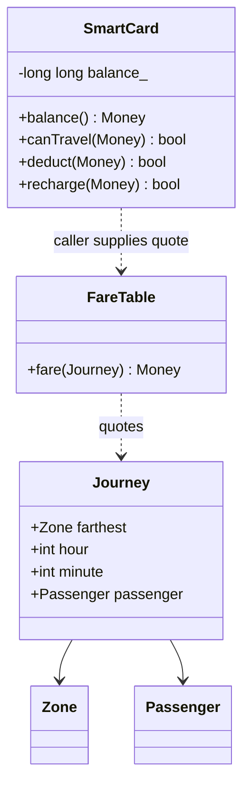

# Task 1 — Objects and invariants

| Object | Data | Behaviour and justification |
|---|---|---|
| SmartCard | Private signed `long long` balance in paise | `canTravel`, `deduct`, `recharge`; centralises balance protection so callers cannot bypass it. |
| Passenger | Adult/student/senior category | Selects a concession policy; eligibility verification belongs outside this classroom model. |
| Journey | Farthest zone, hour, minute, passenger category | Represents one proposed trip independently of whether its payment succeeds. |
| Zone | Scoped enum Inner/Middle/Outer | Restricts meaningful zone names; casts from external data still require validation. |
| FareTable | Shared compile-time fares and rates | Quotes a fare without mutating a card, keeping pricing separate from stored value. |

Encapsulation is the private balance plus checked mutations. Abstraction is requesting
`fare(trip)` without knowing its arithmetic. A future `FarePolicy` interface could have
student/senior/pass implementations (inheritance) selected through a virtual quote
operation (runtime polymorphism). The current small program uses enums and composition:
it does not need an inheritance hierarchy simply to demonstrate OOP.

Rules: money is nonnegative integer paise; invalid times/zones/categories are rejected;
only an accepted trip mutates the card; the remaining balance must be at least 5,000
paise, including equality; failed recharges/deductions leave the balance unchanged;
recharge must be positive and fit in `long long`. A card may initially contain less
than Rs 50 but cannot travel until recharged sufficiently. Both peak intervals are
half open: [08:00,10:00) and [17:00,20:00).

Assumptions absent from the brief: student concession 10%, senior concession 20%,
one category per passenger, concession after peak adjustment, and half-up rounding
to the nearest paisa at each percentage stage. These are modelling choices, not
official Namma Metro rates. The farthest zone is supplied after route validation;
Tasks 1–11 do not infer routes from a real station graph. Time is local metro time.

Procedural alternative: `long long balance; quote(zone,time,category);`
`if (canTravel(balance,fare)) balance -= fare;`. A global balance allows unrelated
functions to violate the reserve. A class makes all mutations pass through one API.
Both take O(1) per journey and O(1) per card; this class has no virtual table.
A fare-rate change modifies one shared table in either well-factored design.
Duplicating rules across m free functions can require O(m) edits, whereas a single
quote function or class needs O(1) edits. OOP alone does not guarantee fewer edits.

Run `python3 scripts/validate.py --task Task01` from the repository root.
`main.expected.txt` contains the expected result; `evidence/` contains the actual
execution and comparison. No external input is required.
