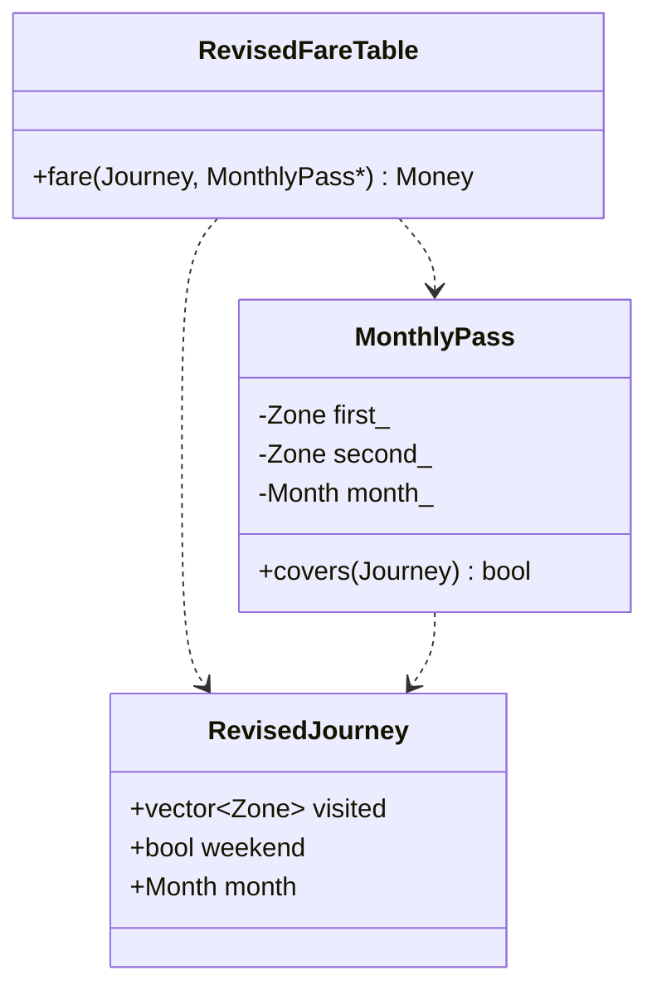

# Task 12 — Day-4 design challenge

## A. Impact analysis

Decision: **MODIFY** the design. Retain integer Money, private SmartCard and its
reserve/recharge checks. Extend pricing through a four-entry fare table and
separate MonthlyPass instead of growing the balance class into a policy engine.

| Original element | Change and reason |
|---|---|
| Zone enum and base table | Add Airport with 6,000 paise. Use a separate revised namespace so original programs remain reproducible. |
| Zone switch | The Task06 teaching skeleton stays intact. Revised pricing uses a validated table index to avoid another switch case. |
| Peak expression | Preserve [08:00,10:00) and [17:00,20:00); apply surcharge only on weekdays. |
| Adjustment expression | Weekend selects 90% of base; weekday selects base plus peak surcharge. The branches are mutually exclusive. |
| Journey | Carry all visited zones, weekend indicator, calendar month/year and category. |
| SmartCard | No structural change: a covered pass supplies a zero fare through the existing checked deduct API. |
| MonthlyPass | New private pair of distinct zones and a calendar month. Valid only when every visited zone is covered in that same month/year. |

## B. Evaluate the original design

A switch can absorb Airport with one case, but adding weekend and pass logic
inside each case duplicates the same rules four times. Keeping one base lookup
and independent adjustments prevents those inconsistencies. The SmartCard already
accepts nonnegative fares and enforces the reserve; it needs no awareness of weekends.

Worked examples: Airport weekday 08:00 = 6000 + 1200 = 7200 paise; Airport weekend
08:00 = 5400 paise, rather than 6480 (the incorrect combination of surcharge and
discount). A valid Inner/Middle pass makes a journey visiting only those zones
free. Adding Outer makes it chargeable by Outer pricing. An Inner/Airport pass
does not cover a trip that also visits Middle. A pass from October 2026 does not
cover November 2026 or October 2027. These are explicit tests, not only examples.

## C. Adaptation and assumptions

`revised.hpp` implements the table, separate pass and pricing rule. `main.cpp`
executes a named expected/actual table, exhaustive quotes and repeated pass trips.
UML extension:

Assumptions requiring faculty confirmation: a pass is valid for one calendar
month (not a rolling 30 days); it is already purchased and attached to the card;
pass purchase cost is outside this task; coverage means all visited zones; a
zero-fare journey still obeys the original Rs 50 reserve; a weekend discount
may combine with student/senior concession (the brief only forbids combining it
with peak surcharge). Concession follows the weekend/peak branch. One category
applies per passenger. Weekend status and validated route zones come from trusted
upstream calendar/routing data; no station graph or calendar-day parser is claimed.
Every input is validated before a zero-fare pass can bypass pricing.

## D. Evidence-based defence

Named cases cover Airport peak/off-peak, weekend precedence, concession ordering,
time boundaries, pass coverage/expiry/year rollover, intermediate zones, malformed
pass/journey data, reserve equality and below-reserve denial. A second oracle
checks 1,440 minutes × 4 zones × 2 day types × 3 categories = 34,560 quotes.
10,000 covered journeys test that a monthly pass has no per-trip decrement and
leaves balance unchanged. Actual results are in `evidence/main.stdout.txt`.

For k visited zones, quote and pass coverage are O(k) time, O(1) auxiliary space
besides the O(k) input route. The pass stores two zones and one month/year, O(1)
space per card. The fare table occupies O(z), with four long long entries (32
bytes on this target). A fixed four-zone bit mask could make coverage O(1) after
route validation, at the cost of an extra representation; the vector is clearer
for demonstrating intermediate-zone checks. Changing prices requires one table
edit; adding rules no longer changes card storage. This supports modification
instead of rewriting a tested monetary invariant.

The revised maximum weekday adult fare is 7,200 paise. At 3 million journeys,
21,600,000,000 paise fits in long long. Real gates still need atomic payment,
authenticated cards/passes, durable records and central policy distribution.

Run `python3 scripts/validate.py --task Task12` from the repository root.
